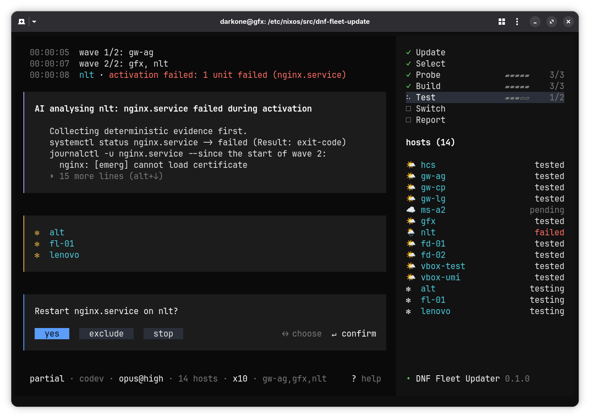

import { Steps } from '@astrojs/starlight/components';

{/* t:translated-from fr */}
{/* t:h 105938957d65ed55bf9c9bc5d4fc332fc008efc27c2d25e2226abd40d5c9e76d */}

{/* t:p 9f291caceb9d77d4bf13f3e426e0ab76f8911f0774057e98a07403fb378e29b4 */}
The fleet is deployed with [colmena](https://github.com/zhaofengli/colmena): a single command builds and applies the configuration on one or more hosts, remotely, from the admin workstation.

{/* t:p d4a06fc139c0d5029ddc5205311c422d5da5a5e1fe1b2e6d014d42aae5b8629c */}
## Apply a configuration

```sh
just apply <target> [action]    # alias : a
```

- **target** = hostname, pattern (`'*'`), list (`a,b`) or colmena tag (`@server`).
- **action** = `switch` (default), `boot`, `test` or `build`.

| Command | Purpose |
|---|---|
| `just apply <target>` | Build + activate on the target(s) |
| `just apply-local` | Apply on the current machine (alias `al`) |
| `just apply-verbose <target>` | Same as `apply` in trace mode (alias `av`) |

:::tip[Build on target]
`apply` builds **on the target host** (`--build-on-target`): the admin workstation doesn't need the power or architecture of the deployed machines.
:::

{/* t:p 811d77666e3af7f7df258aaa798c867fbf3315b7431960b130501f647715c764 */}
## Deploy safely

**Build confidence through action**: each step is less risky than the next.

```sh
just apply <host> build      # downloads + compiles: 100% safe, nothing is activated
just apply <host> test       # activates without switching: no generation, no boot
just apply <host>            # switch: activates and creates a new generation
```

**Progress from core to edge**: deploy nodes in this order, to never cut off
access to a node by the one preceding it.

```d2
style.fill: transparent
direction: right

hcs: HCS
gwl: Local gateway
hl: Local hosts
gwd: Remote gateways
hd: Remote hosts

hcs -> gwl -> hl -> gwd -> hd
```

:::caution[Why this order]
A remote host's connectivity depends on its gateway, which depends on the VPN
coordinated by the HCS. Deploying a link before its support can make subsequent
hosts unreachable.
:::

{/* t:p fca40cb3a60aa02902bf46d2e618fcdd168826893877684ca1a9efddd8002181 */}
## Updating

The system is locked down by *flakes*. Updating = refreshing the inputs,
then redeploying.

```sh
just update-flake     # met à jour dnf/ + racine, commit les locks
just apply '*'        # déploie la mise à jour
```

:::caution[Always test first]
Before a wide rollout, validate locally: `just check`, then
`just apply <pilot-host>` on **a** single test host.
:::

{/* t:p 647d28d621ce0ff0331a1e23a1a8b90c6d3627078081db6f129e515d4fc412a1 */}
## Updating the fleet with fleet-update

`fleet-update` chains the entire update into a single command&nbsp;: flakes,
building all hosts, publishing the locks across the fleet, testing in waves
(hosts the network depends on first), then final activation of the approved
hosts.



:::note[AI at work]
AI **analyzes**, acts on services, fixes code and proposes
improvements&nbsp;: see [AI analysis](#ai-analysis),
[Repairing a service](#repairing-a-service),
[Repairing through code](#repairing-through-code) and
[Improvement suggestions](#improvement-suggestions).
:::

{/* t:p 9a7e349addbc0b65573e6ae2095b537019c20f76d8d392c8884c3d2d566e9281 */}
### Launch

```sh
just fleet-update [options]
```

The recipe picks the tool to run, in this order&nbsp;:

| Situation | Tool run |
|---|---|
| Co-development (`src/dnf-fleet-update/` present) | The sources, with `bun` |
| Active `darkone.admin.fleet-update` module | The installed `fleet-update` command |
| Any other case | `nix run .#fleet-update`, per the project's `flake.lock` |

:::caution[Prerequisites]
- Clean git trees: project, and `dnf/` in co-development.
- `var/deployments/` ignored by git: `/var/*` rule from the boilerplate.
:::

{/* t:p 1005a3ae714503d51514442daa9daa2ea20d453fdac38358beec5684c4e49811 */}
### How a rollout unfolds

<Steps>
1. **Update**: `nix flake update` for the project, then for `dnf/` (co-development), `just clean`, one commit per repository.
2. **Selection**: hosts, profiles and zones read from `var/generated/`, filtered by `--on`; the current zone deduced from the local IP; one builder elected per host.
3. **Build**: all selected hosts, reachable or not, each on its own builder. Presence probed through the deployment SSH connection, which also joins a [roaming host](/en/doc/admin-guide/understand/network/#joining-a-roaming-host).
4. **Publication**: the closure of each reachable host is brought into its store, outside waves, before any activation.
5. **Test**: `switch-to-configuration test`, one wave per profile; the next wave starts once all its hosts are OK or set aside.
6. **Switch**: all hosts validated in test, **in a single go**, out of wave order.
</Steps>

:::note[Why publish before activating]
Serving and activating are two distinct needs. Once each host is served, a wave
no longer depends on anything but `ssh`&nbsp;: a gateway restarting its network
no longer deprives anyone of their substituter.

The host **pulls** first (`nix build --max-jobs 0`, which substitutes without
ever compiling on the spot), and is only **pushed** as a fallback. A failed pull
is the ordinary case&nbsp;: a brand new path is not yet in any cache.
:::

Three options shorten this sequence&nbsp;:

| Option | Effect |
|---|---|
| `--build-only` | Stops after the build; in interactive mode, offers to continue |
| `--skip-test` | No test: the switch happens wave by wave, right after the build |
| `--skip-switch` | No switch: the rollout stops at whatever the test left in place |

:::tip[Preload the fleet without activating anything]
`--skip-test --skip-switch` builds **and publishes**, then stops&nbsp;: each
host holds its closure (`ready` state) without having activated anything. A
subsequent rollout, or a `--resume`, then activates without copying anything
anymore. Useful to separate a large package download from a short intervention
window.

`--build-only` is the other extreme&nbsp;: nothing leaves the deployment
machine, publication itself is skipped.
:::

:::note[Why the switch is not done wave by wave]
Waves protect an unproven configuration. Once the test succeeds on each host,
there is nothing left to protect&nbsp;: the switch goes out in one go, with at
most `--max-parallel` hosts activated simultaneously. With `--skip-test`,
nothing has been proven&nbsp;: the switch resumes the wave order.
:::

:::tip[Resume an interrupted rollout]
`--resume` restarts from the last folder in `var/deployments/`&nbsp;: update
skipped, waves and options of the original rollout, and the hosts that remained
to be done (remaining, offline, failed, or only tested). Builds are reused if
the revisions of the project and of `dnf/` have not moved and the paths are
still in the store&nbsp;; otherwise they are redone. Nothing to resume&nbsp;:
exit code `2`, no rollout.
:::

{/* t:p 4cbcc00e93172e4a8786902b1830beba2568953c2295cdece1cd5aea416d6347 */}
### Distributed builds

The deployment machine must not become the bottleneck of the fleet. Each host is
therefore built by the **builder elected for it**. The election is recalculated on
each run from `var/generated/`, never declared&nbsp;: changing the deployment
topology must not rebuild the fleet.

| Order | Builder selected | Condition |
|---|---|---|
| 1 | The host itself | `auto-build` or `roaming` feature |
| 2 | The `harmonia` host of its zone | The zone has one |
| 3 | The `global` `harmonia` host | One exists in the fleet |
| 4 | The deployment machine | Default |

The rule comes down to one sentence&nbsp;: **a builder must be able to serve what
it builds**. Hence the choice of `harmonia` hosts, whose `/nix/store` is already
their zone's cache, with nothing to prime. A gateway without `harmonia` does not
suit&nbsp;: its paths are in no substituter.

The result stays on the builder. It is the deployment that then brings it to the
zone's hosts, over the LAN, through their usual substituter.

:::note[`nixpkgs` sources downloaded by the builder]
Every system embeds the `nixpkgs` source (about 200&nbsp;MiB), new with each
update and absent from any cache. Before sending it the derivations, the tool
therefore asks the builder to download from GitHub, by itself, the sources locked
in `flake.lock` that its builds need&nbsp;: they no longer go through the uplink of
the deployment machine. A builder that cannot reach `github.com` receives them
pushed, as before, without failure.
:::

```yaml
# etc/config.yaml
    features: ["auto-build"]
```

:::tip[When to declare `auto-build`]
A host that builds itself no longer receives any closure. This is decisive for an
isolated host behind a slow link that embeds a large package absent from the
public cache, and it is the answer for a host of another architecture.

The choice is made **per host**, never per zone&nbsp;: RAM and disk are
properties of the machine. The trade-off to weigh&nbsp;: the closure of the
derivations, several hundred MiB, is pushed towards it on each run that moves
`nixpkgs`. It is the report's copy counters that settle the case, not intuition.
:::

:::note[Automatic fallback]
Builder unreachable, failing, or of an architecture incompatible with its
target&nbsp;→ the build falls back to the deployment machine. No host fails
because of a delegation, and the report names the builder that actually built.
:::

The `--no-distributed-build` option brings everything back to the center,
whatever the election. It is a debugging escape hatch&nbsp;: the rule comes from
the fleet, the exception from the command line.

:::caution[A zone without `harmonia` costs a lot]
Without a zone cache, there is neither a local builder nor a shared source&nbsp;:
each host has its closure pushed to it, one by one, from the deployment machine.
The report lists these zones and the number of pushed bytes shows it. Declare a
[`harmonia`](#binary-cache) on a host of the zone.
:::

{/* t:p b140e2ce0eadf1058d08e62ea6b45ab657f3afb8135d13b213923d61ddf46539 */}
### Wave order and critical hosts

The fleet's default values are declared in `config.yaml`&nbsp;:

```yaml
# etc/config.yaml
network:
  fleetUpdate:
    deploymentOrder: "hcs:gateway:server:[others]:laptop"
    criticalProfiles: "hcs:gateway:server"
```

| Key | Role |
|---|---|
| `deploymentOrder` | One test wave per host profile, in that order |
| `criticalProfiles` | Profiles whose failures also go to the incident room |

Profiles separated by `:`, `[others]` designates the unlisted profiles. Optional block&nbsp;: without it, the tool applies the values above. The `--deployment-order` and `--critical-profiles` options take precedence over `config.yaml`.

{/* t:p 214dd9d0d8b581abe98af854adfac1e1807d76c7b9845729d97a41c04566c4b9 */}
### Timing and monitoring

Two other optional blocks in `config.yaml` set the durations&nbsp;:

```yaml
# etc/config.yaml
network:
  fleetUpdate:
    pingInterval: 15
    timeouts:
      build: 10800
      ssh: 30
```

| Key | Role | Default |
|---|---|---|
| `pingInterval` | Seconds between two presence probes | `15` |
| `timeouts.<key>` | Maximum duration of an operation, in seconds | depends on the operation |

`timeouts` keys, in the order of the rollout&nbsp;:

| `timeouts.<key>` | Default (s) |
|---|---|
| `flakeUpdate` | 120 |
| `clean` | 60 |
| `commit` | 60 |
| `eval` | 1200 |
| `build` | 10800 |
| `publish` | 3600 |
| `copy` | 3600 |
| `activation` | 300 |
| `ssh` | 30 |
| `ping` | 5 |
| `matrix` | 30 |
| `killGrace` | 10 |

:::note[An unknown key stops generation]
`just generate` checks key names and refuses a zero or negative duration&nbsp;:
a typo would otherwise silently fall back to the default value.
:::

{/* t:p 99d045f2da864a2a62675432f5b261163caaaa11d7dea2034ff2be4239620384 */}
### Errors, diagnostics and repair

A common error should be readable without knowing Nix. The tool keeps a **signature
table**: a recognized pattern in a command's output gives a plain-language
message and the action to take.

| Recognized pattern | What it means | Action |
|---|---|---|
| `mismatch in field 'narHash'` | `nix-eval-jobs` isn't bound to the same Nix as the system | Stop |
| `lacks a signature by a trusted key` | The deployment account isn't a *trusted user* on this host | Stop |

The message is shown as the run progresses (`hint:`), once only, and is also
found in the report's **Known errors** section. It is added to the host's reason,
it never replaces it: the full trace stays in `logs/`.

| Table action | What the tool does |
|---|---|
| Retry | Replays the command, at most three times, if it is replayable: evaluation, build, derivation copy, pull |
| Exclude | Continues without the host; if already activated, first brings it back to its origin |
| Stop | Stops the run, without asking any question |

No signature calls for a retry today: the two known entries are stops.

:::caution[A table action is not discussed]
It also applies in interactive mode: a deterministic repair comes before the
question. A nightly run and a supervised run therefore handle the same error
the same way. The `known error decides: stop` line says it as the run
progresses, and the host's reason stays in the report.

Activation, profile installation, commit, and unit restart are **never**
replayed on their own: only commands that can be re-executed without
consequence are.
:::

**Deterministic collection.** A host that fails while remaining reachable is
interrogated before any decision: `systemctl status`, list of failing units, then
each one's log since the start of its wave.

| What is collected | Where it goes |
|---|---|
| Full output of commands and logs | `logs/<hôte>.diag` in the run folder |
| Failing units, error extract | Report's **Diagnostics** section, incident message |

**Unit restart.** An activation that ends with failing units leaves the host in
`error` state. The tool then attempts a simple repair.

<Steps>
1. Ten-second wait: a unit that is slow to start isn't a failing unit.
2. `systemctl restart` of all the failing units, in a single command.
3. Re-reading the failing-unit list: it is what concludes, not the exit code.
</Steps>

Everything comes back up → the host resumes its course, rejoins the switch with
the others, and the report notes a **probable activation-order issue**
(**Notes** section). A unit resists → the host stays in `error`, its name and the
unit's are in the report.

:::note[What the interface shows meanwhile]
The host carries a blinking label to the right of its name, with its activity
indicator: `under repair` in yellow during deterministic repair,
`AI analysis` and `AI repair` in magenta when the AI takes over.
:::

{/* t:p 2c3384ba13366ddd2216784bfd722ee28528c2237a8f297c349b3722644b335e */}
### AI analysis

The AI **explains** a failure: it reads the launch state, the logs and, if needed, the code, then produces an analysis in plain language. With `--ai-error-action repair` it can then **act**: on failed units, or on the code (see [Repair a service](#repairing-a-service)). An analysis that fails, exceeds its timeout or its budget leaves the host exactly where it was.

Two options control it, **both set to `none` by default**: nothing is sent to an AI until it is requested. A third chooses the tool.

| Option | Default | Role |
|---|---|---|
| `--ai-analysis none\|passive\|active` | `none` | Analysis depth, and end-of-launch synthesis in the report |
| `--ai-error-action none\|analysis\|repair` | `none` | What the AI does when a host fails |
| `--ai-model <outil>[:<modèle>][@<effort>]` | `claude:opus@high` | Tool and model, for example `opencode:ollama/qwen3:32b` |
| `--ai-context <texte>` | none | Instruction or context added to all AI prompts |

```sh
just fleet-update --ai-analysis passive          # rapport enrichi, rien de plus
just fleet-update --ai-error-action analysis     # chaque échec est expliqué
```

For example, `--ai-context "Répondre en français et rester concis."` guides the style of the answers. To avoid repeating it at each launch, set it once for the host with the module's `aiContext` option: it writes it to `/etc/fleet-update/ai-context`, which every launch reads, `just fleet-update` as well as the timer. The `--ai-context` option takes precedence over this file. On resume, the context of the initial launch is reused; an explicit `--ai-context` replaces it.

```nix
# usr/machines/<hôte>/configuration.nix
darkone.admin.fleet-update.aiContext = "Répondre en français et rester concis.";
```

The fleet's default model is set in `config.yaml`, the option takes precedence:

```yaml
# etc/config.yaml
network:
  fleetUpdate:
    aiModel: "claude:opus@high"
```

**AI tools are not a dependency of the tool.** `claude` and `opencode` are looked up in the `PATH`; the module's `aiPackages` option puts them there for the daily launch. Absent or refused&nbsp;→ a warning in the launch stream, a note in the report, and the rest proceeds without AI.

{/* t:p e3247543ece0e12ab348f73767b648fb99f9b90567096cfe61a29e701d72f1cd */}
#### What the AI is allowed to do

The AI has **no free shell or SSH**. It acts only through the tools of `fleet-update`, and the requested level fixes the list presented to it: what it does not see there, it cannot ask for.

| Level | Tools presented |
|---|---|
| `passive` | Launch state, host diagnostic, build and activation logs, grouped launch warnings |
| `active`, `analysis` | + reading, searching and listing the code (project and `dnf/`), host units and logs (user units included), read-only |
| `repair` | + an action on a host's failed units, and editing the code that describes them |

The level used is the **highest of the two options**: `--ai-analysis passive --ai-error-action analysis` gives `active`. The built-in tools of `claude` and `opencode` are disabled, and the instructions these tools would pick up in the project (`CLAUDE.md`, user settings) are neutralized: the AI sees only what it is shown.

| Safeguard | Effect |
|---|---|
| Read path | Confined to the project and to `dnf/`, after resolving links; `usr/secrets/` and `.trash/` refused |
| Host, unit | Checked against the launch table before any command |
| Excerpts | 200 log lines, 400 source lines, truncated at the end: the error is at the bottom |
| Timeout, budget | 300 seconds per analysis, two hours per repair session; 4 dollars per session for `claude` |

**Every tool call leaves a trace** — a line in the launch stream (`AI reads usr/modules/nginx.nix`) and a line in `logs/ai.log` of the launch folder. A call refused by a safeguard is traced too, with its reason.

{/* t:p 9684c00e6ed4bb36a4b06aa1a0fed37f43485ff305157938278f94c6e4fc5a15 */}
#### When it intervenes

<Steps>
1. **A host fails**, with `--ai-error-action` ≠ `none`: after the deterministic collection and the restart of units, before the question that decides its fate. The host shows `AI analysis` in magenta during this time, then returns to its state.
2. **A build fails**, with `--ai-error-action` ≠ `none`: at the end of the build, one analysis per group of hosts broken by the same error, before the decision (see [Repair a build](#repairing-a-build)).
3. **A host recovers** after a unit restart, with `--ai-analysis` ≠ `none`: the analysis explains the activation order, without touching the host state.
4. **End of launch**, with `--ai-analysis` ≠ `none`: a synthesis of the whole, written before the report that carries it.
5. **End of launch**, with `--ai-analysis active`: a review of the warnings, which files [improvement suggestions](#improvement-suggestions).
6. **Press `a`**, at any time: a free question. It gets an answer even under `--ai-analysis none` — without any tool: `none` removes the tools and automatic analysis, not the conversation.
</Steps>

{/* t:p 2cf96bc85ae42256523f7f27abb300866f40d4ceb9f6f5b61675cbe346b1c92e */}
#### Repairing a service

`--ai-error-action repair` opens a **second session** on the host, right after
the analysis and in the `AI repair` state. The first of its tools acts on
services: `systemctl start`, `stop`, `restart` or `reset-failed` **on the
units the run saw fail**. This is the gesture to prefer: it
is local and reversible. When it is not enough, the AI fixes the code
([Repairing through code](#repairing-through-code)).

```sh
just fleet-update --ai-error-action repair
```

<Steps>
1. The grouped deterministic restart failed: the host stays in `error`.
2. The AI analyses, in the `AI analysis` state, read-only.
3. The AI repairs, in the `AI repair` state: it acts, then re-reads the failed units.
4. Nothing failing anymore → the host resumes its course and joins the switch. Otherwise → the usual question, `revert` / `keep` / `stop` / `rollback`.
</Steps>

| Guard-rail | Effect |
|---|---|
| Units | **Only those the collection saw failing** on this host; any other is refused |
| Host | Refused if it is not currently being repaired: a read session never acts |
| Attempts | Three actions per host, refusals not counted; the fourth is refused |
| Stopping mid-run | A run that stops repairs nothing: it is a new operation |
| Confirmation | In interactive mode, a button question before each action: `apply` or `skip` |

In non-interactive mode (night timer, `--no-ui`), **the action passes without asking**.
It is strictly less risky than what the run already does without
witness: the deterministic repair restarts **all** the host's
failed units.

Each action is **counted**, not just traced: it ends up in
`state.json` and in the **AI repair** section of the report, refusals included, with its
reason. A repaired host also carries a note in the report.

{/* t:p 8f0a3fc4facaac969338dc45d429c00ef06f32b27ad958a258cbaee1e16bc4a3 */}
#### Repairing through code

When no restart can help, the AI **writes the fix** into the project, validates it and commits it; the host is rebuilt then redeployed, and the rest of the fleet follows the commit ([Align the fleet](#aligning-the-fleet)).

<Steps>
1. `edit_code` replaces an exact passage (present only once), or rewrites a whole file. The git tree must be clean before the first edit, and the diff goes into `logs/ai.log`.
2. `validate` runs the project cleanup, then re-evaluates and rebuilds **that host alone**, from the working trees: an uncommitted edit of `dnf/` and a created file are seen there. An edit that does not change the host is reported.
3. `commit` writes `fix(<scope>): <sujet>`, the scope naming what the fix touches (`fix(nginx): …`). In co-development, `dnf/` is committed first, then the project and its lock realigned.
4. The host goes back to `built` with the committed path; its wave serves it once more: copy, activation, conclusion.
</Steps>

| Safeguard | Effect |
|---|---|
| Paths | The project, and `dnf/` in co-development; never `usr/secrets/`, `.trash/`, `.git/`, `var/generated/`, `etc/config.yaml` nor a `*.lock` |
| Outside co-development | `dnf/` is a store path: writing it is refused, and would have changed nothing |
| Tree | Dirty before the first edit → refused: a repair commit carries only the fix |
| Attempts | **Six per host, one attempt per change**: a service action, or the edits until the next `validate`. Validating and committing cost none |
| Validation | `commit` refused if the last edit is not validated: what is redeployed is what is committed |
| One commit per fix | Fixing again **amends** the `fix` commit of the fix, as long as it is at the head; never the `chore(update)` nor a human commit |
| One session at a time | Repairs run one after the other: a commit takes the whole tree |
| End of session | Uncommitted edit discarded, tree brought back to the last commit; the diff remains in `logs/ai.log`, and as a patch in `logs/<hôte>.dnf.patch` (or `.consumer.patch`) for `git apply` |
| Hooks | Never bypassed: the commit goes through the repository gate like any other |
| Message | `dnf/` is published: a framework commit that names a fleet host is refused |

:::caution[Also in non-interactive mode]
Under the night timer, the AI edits, commits and redeploys **without asking**, including a failing build. An unreviewed commit can therefore land on the branch. What makes this bearable: the required clean tree, the confined paths, the logged diff, the bounded attempts, and the automatic rollback that remains armed. If this is not what you want, leave `--ai-error-action` at `none` or at `analysis` in `timer.extraArgs`.
:::

:::caution[What AI repair is not]
It is neither the [deterministic repair](#errors-diagnostics-and-repair) (grouped restart, once, without AI), nor the re-run of a command decided by the signature table, nor a decision — excluding or stopping comes first, without asking. The AI only comes after what is deterministic.
:::

:::note[The analysis adds, it replaces nothing]
The raw reason of a host, its failed units and the whole trace of `logs/` remain what they were. The analysis completes them, like the plain-language message of a known error.
:::

{/* t:p af06bb9658dbb5b52bf144c41d63083632738a8a99f666810646150b7df77a22 */}
#### Repairing a build

A build can fail because of the code: a package's tests, a badly written option. With `--ai-error-action` ≠ `none`, the AI handles it at the **end of the build**, before the usual decision; built hosts wait.

<Steps>
1. Hosts broken by the same error form **one group**: one session for all.
2. The AI analyzes the group, in the `AI analysis` state, read-only.
3. With `repair`, it fixes in the `AI repair` state, through the host that built the failing derivation: `edit_code`, `validate` (which rebuilds that host), `commit`.
4. Fix committed → the fleet aligns, including the hosts of the group. Nothing committed → the usual decision: exclusion or stop.
</Steps>

| Case | Effect |
|---|---|
| Known `stop`, `exclude` error | Decides alone, without AI |
| Failure outside the code (killed builder, network) | Usual decision, without AI |
| Fleet evaluation fails | Nothing to attribute, no session |
| All hosts broken | Repair attempted before the `no host built` stop |
| `--build-only` | Repairs too |

{/* t:p b5fc12b1de7425df843b9d4b6933b9767dac75b1c551af62dec1a84a2d0d5ec4 */}
#### Aligning the fleet

Everything the launch publishes and activates comes from **a single revision**, the last commit. A fix may require several hosts to move together (a server and its clients): each repair commit realigns the fleet.

<Steps>
1. All hosts still in the launch are re-evaluated at the last commit, in a single evaluation.
2. Only those whose path changes are rebuilt; the others do not move.
3. Host not yet served by the step → its wave serves it, new path included. Host already served → served again in a **final pass** of the step, same phase.
</Steps>

A host that the alignment breaks goes to the decision, never to a new repair. A host can also remain **behind**:

| Case | The host |
|---|---|
| Rebuild fails, in waves | Keeps its generation and its path |
| Unreachable at the final pass | Returns to its previous state and path |
| Commit during the final pass | No more alignment after it |

The fleet then runs **on two revisions**: the report and the incident room say so, with the hosts concerned (see [Report and Matrix alerts](#report-and-matrix-alerts)). `--resume` reuses the aligned paths; cut before the alignment, it rebuilds everything.

{/* t:p ade7d48f8119a0bde2ab5efd314b9626b4b792b96de645fb45e4b2bfe4d7d269 */}
#### Improvement suggestions

With `--ai-analysis active`, the launch ends with a **review of its warnings**, and of what the repairs left to a human: renamed or deprecated option, a change that would silence a warning, a problem to investigate, a limit of the repair tool. The AI proposes, it changes **neither the code nor the fleet**.

<Steps>
1. The warnings from all launch logs are grouped by shape: the same one on ten hosts counts once. No warning or repair → no review, nothing is paid.
2. The AI reads the suggestions already filed and the conclusions of the repairs, then searches the code for where each warning comes from.
3. Each useful finding becomes a file `var/deployments/suggestions/<slug>.md`: what, where (`fichier:ligne`), why, and the proposed improvement.
4. The **Suggestions** section of the report lists what the launch filed or reviewed. Nothing is sent to Matrix: this is not an alert.
</Steps>

The files **survive across launches**. A finding that comes back does not rewrite its file: only the `Last seen` and `Runs` lines of the header move.

```markdown title="var/deployments/suggestions/nginx-deprecated-option.md"
# Replace a deprecated nginx option

- Status: open
- First seen: 20260101T020000Z-full
- Last seen: 20260108T020000Z-full
- Runs: 4

The option is deprecated upstream: `usr/modules/web.nix:12`, …
```

| To | Do |
|---|---|
| Silence a suggestion | Write `Status: ignored` in its header: it stays tracked, out of the report |
| Forget it | Delete the file: a finding that comes back starts from scratch |
| Apply it | Fix the code, then delete the file |

Scope follows the mode: in co-development, the project and `dnf/`; otherwise, the project alone (a finding that only the framework fixes is not filed).

{/* t:p 2c2fbd5c5f6918465212c870ab473fc7f5fb90c992cae8fd555c2043028d2aae */}
### Report and Matrix alerts

Each launch writes its folder in `var/deployments/<date>-<mode>/`: `report.md` (the report), `state.json` (the state that `--resume` resumes), `events.jsonl` and the per-host logs. The path is displayed at the end of the launch.

The report details what the launch actually did:

| Section | What it gives |
|---|---|
| **Steps**, **Waves** | Duration of each step, composition and duration of each wave |
| **Builders** | Who built what, fallbacks included |
| **Copies** | Per host: paths pulled and by which substituter, paths pushed, volume |
| **Zones without a cache** | Launch zones that no `harmonia` serves |
| **Hosts not deployed** | Hosts left aside, and the reason |
| **Diagnostics** | Per failing host: failed units, then error excerpt |
| **Notes** | What the launch found: probable activation order after a unit restart |
| **AI analysis** | AI analysis: one entry per analyzed host, then the launch synthesis |
| **AI repair** | AI actions: host, action, outcome, and the reason for a refusal |
| **Suggestions** | Improvement suggestions filed or reviewed by the launch, excluding ignored ones |
| **Known errors** | Traps recognized by the signature table, in plain language |

The header lists the launch commits, an amended fix counted (`amended 2×`). After a repair commit, it says whether the fleet is [aligned](#aligning-the-fleet):

| Fleet | Header line |
|---|---|
| Aligned | `Repaired by commit: <hôte>, fleet aligned on it` |
| On two revisions | `Repaired by commit: <hôte>, fleet on two revisions — <raisons>` |

:::tip[Reading the copy counters]
A host that pulls most of it from `harmonia <zone>` proves that its zone cache plays its role. A host that has a lot of volume **pushed** to it is on the contrary a candidate for a `harmonia` in its zone, or for `auto-build`. No copy line for a host&nbsp;→ it already held everything, nothing travelled.
:::

The `--send-report` option sends this report to the channels of the [alerts bot](/en/doc/admin-guide/operate/alerts/), installed beforehand by `just configure-alert-bot`.

| Situation | Channel | Content |
|---|---|---|
| Launch finished | warnings | Summary: hosts by state, duration, known errors |
| Critical hosts not deployed | incidents | Separate message: hosts concerned, reasons and failed units |
| Fleet on two revisions | incidents | Hosts behind, and why |
| Stop on error | incidents | Error that stopped the launch, then summary |

A host is critical when its profile appears in `criticalProfiles`. After a stop, the hosts left in `test` complete the incident message: a restart would bring them back to their previous generation.

**Only the end-of-launch synthesis** joins the message, never the per-host analyses, and it is limited there to six lines: beyond that, the message points to `report.md`. An alert channel is not a report.

The message repeats the report header, the exit code in the title:

```markdown
**Fleet Update Report** (1)

Error: srv-maison: activation failed

- Started at 2026-09-17 02:00:00 UTC, duration: 4m12s
- Options: full run, selection all, test skipped, 10 in parallel
- Hosts: 5 deployed (hcs, gw-maison, pc-maison, gw-atelier, lt-atelier), 1 failed (srv-maison)
- Run stopped on error
```

:::note[Sending impossible]
The launch remains valid and the report is written, but the command exits with `3`. Under the timer, the unit fails, so the `SystemdUnitFailed` alert fires.
:::

:::caution[What sending requires]
Sending goes through the [`just send-msg`](/en/doc/admin-guide/operate/alerts/#sending-a-message-to-a-room) recipe: channels and token remain the framework's responsibility, the tool only writes the text. Nothing is sent if the bot is not provisioned, nor on an abort (`^C`, service stop).
:::

{/* t:p 826bb022475cb8d9781021ef6fd0bc3511cbb2f47710deaa651789017a429b58 */}
### Daily run

On the deployment host, the module installs the tool and, with `timer.enable`, runs `fleet-update --no-ui` every day&nbsp;:

```nix
# usr/machines/<hôte>/configuration.nix
darkone.admin.fleet-update = {
  enable = true;
  user = "admin";
  aiContext = "Répondre en français et rester concis.";
  timer.enable = true;
};
```

| Option | Default | Role |
|---|---|---|
| `user` | none | Project owner: git, age key, AI, Matrix |
| `workDir` | `/etc/nixos` | Consumer project on disk |
| `aiContext` | `null` | Context added to the AI prompts of every run on the host, written to `/etc/fleet-update/ai-context`, even without `enable`&nbsp;; `--ai-context` overrides it |
| `timer.onCalendar` | `*-*-* 04:00` | Run time |
| `timer.extraArgs` | `[ ]` | Options added to `--no-ui`, `--send-report` for example |
| `timer.timeout` | `6h` | Maximum duration of a run |

:::note[Exit codes and alerts]
A run already in progress (code `4`) is not an error. Any other failure,
or a `timer.timeout` overrun, fails the unit and triggers
the `SystemdUnitFailed` [alert](/en/doc/admin-guide/operate/alerts/).
:::

:::caution[Deployment account and host]
The timer requires `darkone.admin.nix` on the host, and a `user` account with
passwordless `sudo`.
:::

:::note[Daily report]
`--send-report` will become the default for `timer.extraArgs` when the packaged
version of the tool knows how to send it. Add it in the meantime, after checking
the delivery by hand.
:::

{/* t:p fdeb8b77cc7c001574b394ea24f09825516cb243c05b43cca28a4183223bff62 */}
## Binary cache

Two services combine to avoid recompiling or re-downloading derivations on each
deployment.

| Service | Role |
|---|---|
| `harmonia` | Serves the local `/nix/store`, signed, **directly** to hosts (LAN, or VPN if it is `global`). |
| `nix-cache` | Per-zone `nginx` proxy that caches the public `cache.nixos.org` cache on the gateway. |

A `harmonia` host has a second role: it is the
[elected builder](#distributed-builds) of its zone, because it can serve what
it builds.

A host queries these sources in the following priority order. The first fetch
from the Internet is thus pooled for the whole zone.

| Priority | Source | Scope |
|---|---|---|
| 20 | zone `harmonia` | LAN, what the zone has compiled |
| 35 | zone `nix-cache` proxy | LAN, pooled mirror of the public cache |
| 40 | `cache.nixos.org` direct | safety net if the gateway is down |
| 45 | `global` `harmonia` | last resort, over the VPN |

:::note[How the order is guaranteed]
Nix does not follow the order of the `substituters` list; it sorts caches by the
priority each announces in its `nix-cache-info`. But these announced values are
equal: all `harmonia` declare 30, and the proxy relaying `cache.nixos.org` as-is
declares 40, like direct access to the public cache. DNF therefore sets the
priority in the substituter URL (`?priority=35`), which overrides the announced
value and makes the table order explicit.

Two intended consequences. The zone proxy comes **before** direct access to the
public cache, without which zone pooling would never happen. And a `global`
`harmonia` comes **after** that public cache: `harmonia` serves an entire
`/nix/store`, without being able to tell what it compiled from the rest, so a
well-stocked host would capture all the traffic the public cache should serve. As
a last resort, it is only queried for what `cache.nixos.org` does not have, that
is, its own builds.
:::

:::note[A host does not use its own `harmonia`]
This service serves its own `/nix/store`, so it can only provide paths already
present locally. On this host, everything missing necessarily comes from another
source: that is normal, its `harmonia` only benefits the **other** machines in the
zone.
:::

:::tip[Roaming host (multi-zone laptop)]
A laptop that changes zone must not keep substituters pinned to its declared
zone: unreachable elsewhere, they cost timeouts on every request. Declare it
roaming:

```yaml
# etc/config.yaml
    features: ["roaming"]
```

Its substituters become **neutral** names (`harmonia.dnf.internal`,
`nix-cache.dnf.internal`) that each zone's DNS resolves to its own caches → the
cache follows the machine. Outside any zone, immediate NXDOMAIN response → direct
fallback to `cache.nixos.org`, with no delay. Signature keys being common to the
whole network, nothing else to configure.

Outside a zone, no cache in the fleet serves it: `fleet-update` therefore builds it
on itself, like an [`auto-build`](#distributed-builds) host. For a one-off
move, the `darkone.service.nix-cache.roaming` option alone is enough.
:::

**At installation**, `just install` hands the host's caches to the installer when
the target address belongs to a zone network.

Outside a zone (public IP, box LAN) and for any gateway (its zone caches go
through it), the installer only queries `cache.nixos.org`: the rest comes from the
administration workstation.

:::note[Activation]
`harmonia` and `nix-cache` are [services](/en/doc/admin-guide/operate/services/)
to activate on a host in the network (`nix-cache` on the zone gateway). The
harmonia signing key is managed by
[sops](/en/doc/admin-guide/operate/secrets/) (`just configure-admin-host`).
:::

:::tip[Why a single-upstream proxy]
`nix-cache` relays only **one** upstream (`cache.nixos.org`): it caches `narinfo`
and `nar` as-is, signatures intact. No URL rewriting and no database, hence no
HTTP 500 "invalid nar hash" error from the old `ncps` relay.
:::

{/* t:p 54036d97ac85014a52079c024508dd3fbf02c05c1a43782ae13514626aaf9fa1 */}
## Build farm

Fetching a package and building it are two distinct needs. The binary cache
above covers the first. For the second, a powerful host of the network can take
on the long compilations of an administrative host.

Declare it with the `build-farm` feature:

```yaml
# etc/config.yaml
    features: ["build-farm"]
```

Each administrative host then adds it to its `nix.buildMachines`, joined over
SSH by the deployment account `nix`. Nothing else to configure: the key and the
authorization are already in place across the whole fleet.

:::tip[Only long compilations go away]
The delegation is deliberately narrow: the farm is only offered derivations
declaring `requiredSystemFeatures = [ "big-parallel" ]`, i.e. the kernel,
browsers, `llvm`, `rustc`... Everything else is built locally. This is decisive
when the farm is behind a slow link, since only the requested result makes the
return trip.

Adjust with `darkone.admin.nix.remoteBuilders`: `maxJobs`, `speedFactor`, and
`mandatoryFeatures` (empty list = everything goes to the farm).
:::

:::note[`build-farm` or `auto-build`?]
Two distinct mechanisms, combinable on the same host.

| Feature | Who uses it | What it moves |
|---|---|---|
| `build-farm` | Nix, on administrative hosts | Only the `big-parallel` derivations, whatever tool is launched |
| `auto-build` | `fleet-update`, at fleet build | The whole system closure of the host that declares it |

`build-farm` relieves an admin machine of its long compilations.
[`auto-build`](#distributed-builds) removes a transfer to a host. They do
not replace each other.
:::

:::caution[A farm is not a priority cache]
Do not promote a remote farm to a priority `global` `harmonia` to share its
results: `harmonia` serves the whole `/nix/store` and would capture the traffic
the public cache must serve, across the slowest link of the network. That is the
role of level 45 of the table above: last resort, never primary source.
:::

:::note[Fallback if the farm is unreachable]
The administrative host keeps `big-parallel` in its own `system-features`. When
the farm does not answer, Nix simply resumes the compilation locally instead of
failing. Do not remove this feature to force delegation.
:::
